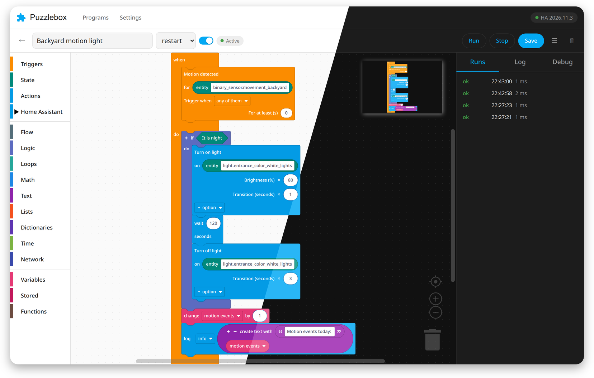
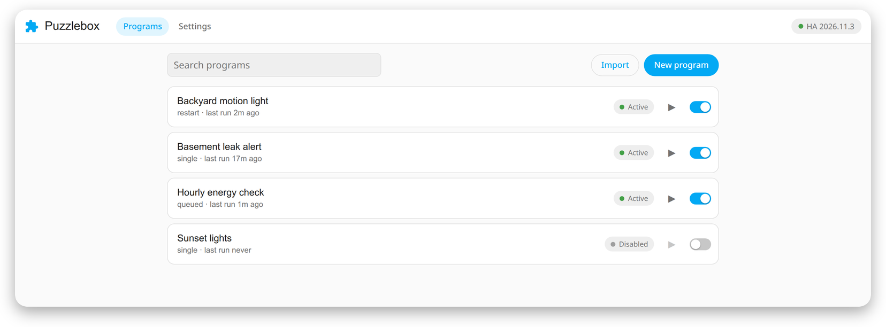
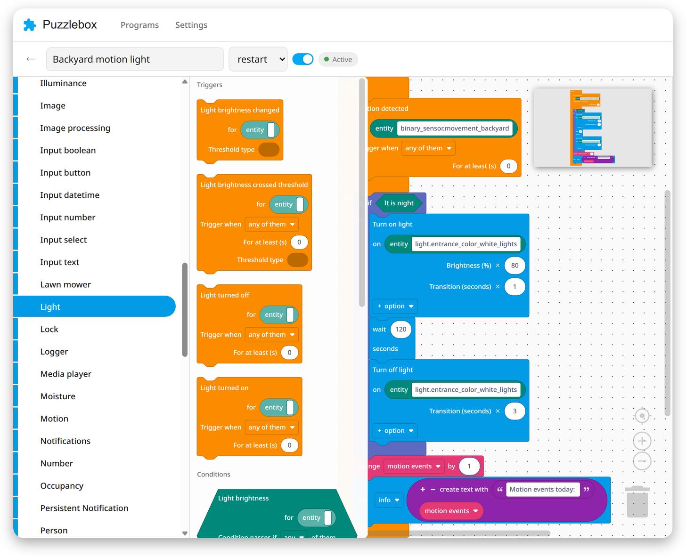
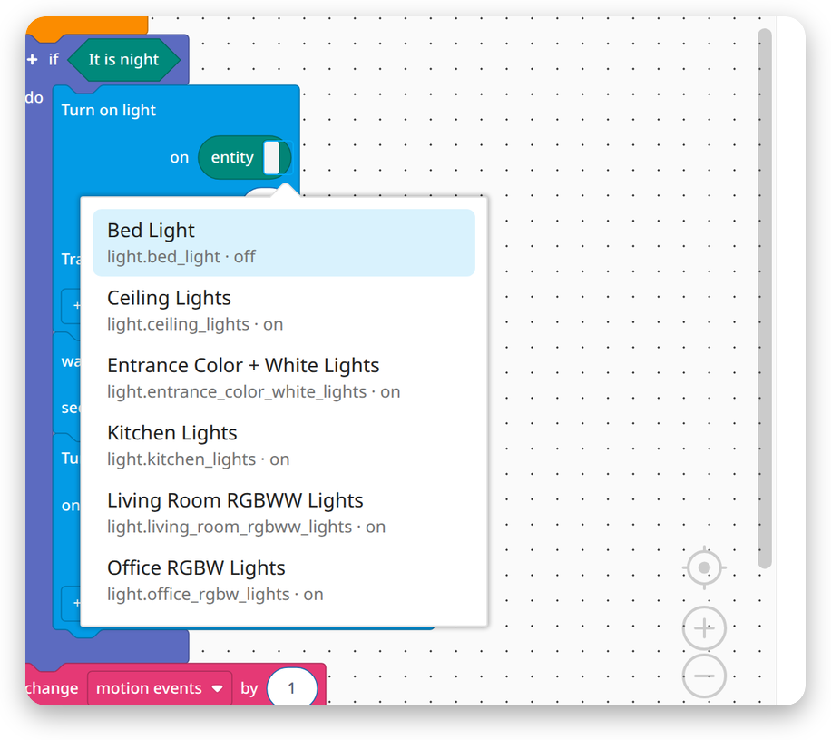
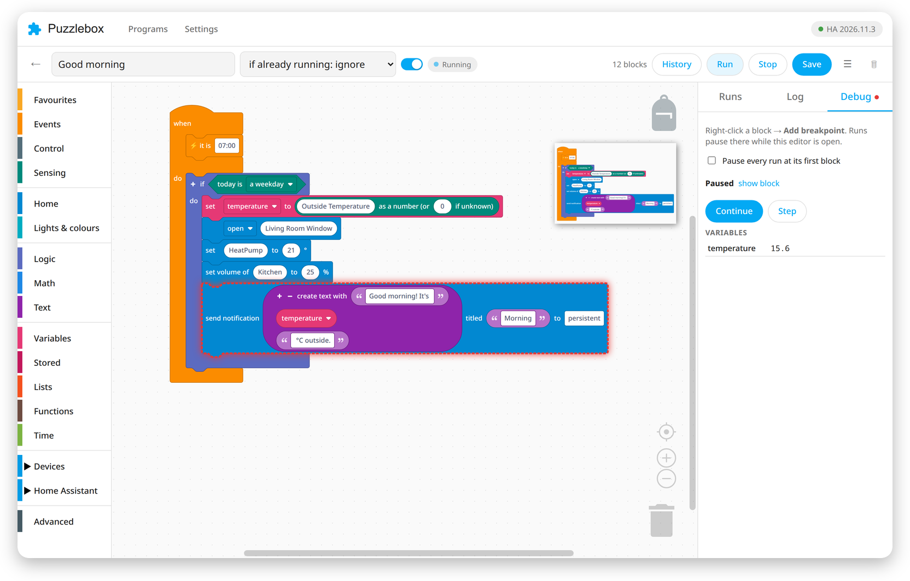
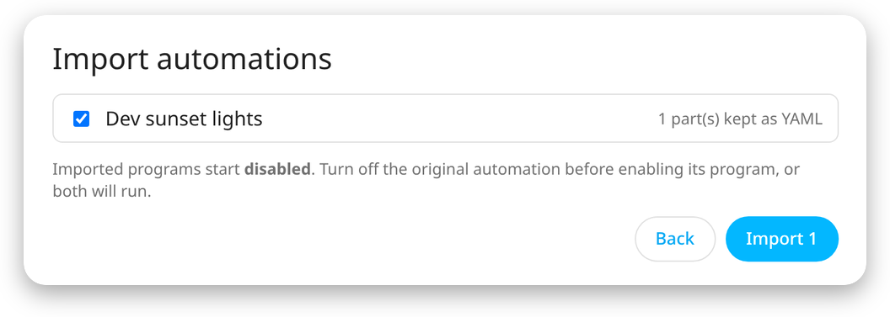

# Puzzlebox

Build Home Assistant automations by snapping blocks together.

Puzzlebox is a Home Assistant app with a visual editor for automations. Every
trigger, condition and action in your installation is available as a block,
and you can go further than regular automations: variables, loops, functions,
error handling, schedules, webhooks, HTTP requests and MQTT.

## Features

- Blocks for everything in your Home Assistant, with proper names, dropdowns
  and an entity picker. New integrations show up automatically.
- Your devices' triggers, conditions and actions, grouped by area, and
  Zigbee2MQTT devices and groups as blocks.
- Timers ("turn off 5 minutes after the last motion"), "wait until",
  rate limits, recorder history and scene cycling.
- Real programming when you need it: variables (also ones that survive a
  restart), lists, dictionaries, loops, functions, try/catch and parallel
  branches.
- A run history with step-by-step traces, a live log, and a debugger with
  breakpoints.
- Editor helpers: add blocks by typing (Ctrl+Space), switch a block to a
  related one, find and rename uses, run a single stack, and a backpack for
  reusing blocks across programs.
- Import your existing automations and scripts.
- Each program gets a switch and a run button in Home Assistant.
- Follows your Home Assistant theme, including dark mode.
- Extensible with block packs, blocks from other integrations, and sandboxed
  plugins.

## Screenshots

All your programs in one list, with their status and when they last ran:

Every trigger, condition and action from your installation, grouped by
integration:

Pick entities by name instead of typing IDs:

Set a breakpoint, run the program and look at the variables while it's paused:

Bring over the automations you already have:

## Installation

You need Home Assistant OS or a Supervised installation.

1. In Home Assistant, go to **Settings → Apps → App store**, open the ⋮ menu,
   choose **Repositories** and add
   `https://github.com/TechGigant/puzzlebox`.
2. Install **Puzzlebox** and start it. It appears in the sidebar.
3. Install the **Puzzlebox** integration through HACS (add this repository as a
   custom repository, category *Integration*) and restart Home Assistant.
   The integration finds the app and sets itself up.

The integration is optional, but without it programs don't show up as
entities and the extra actions, events and webhooks aren't available.

## Getting started

1. Open **Puzzlebox** from the sidebar and click **New program**.
2. Drag a trigger from **Triggers** or **Home Assistant** into the *when*
   block.
3. Add actions under *do*, for example **Home Assistant → Light → Turn on
   light**.
4. Click **Save**. The program runs whenever the trigger fires, and the
   **Runs** tab shows what happened.

To move an existing automation over, click **Import** on the program list.
Imported programs start disabled, so turn off the original automation before
you enable the program.

## Using programs from Home Assistant

With the integration installed you get:

- a switch per program to enable or disable it, and a button to run it
- a sensor per global variable
- the actions `puzzlebox.run_program` and `puzzlebox.set_variable`
- the events `puzzlebox_program_started` and `puzzlebox_program_finished`
- webhook triggers on your Home Assistant URL (`/api/webhook/<id>`)

## Zigbee2MQTT

If you use Zigbee2MQTT, its devices and groups appear under **Zigbee2MQTT**
in the editor: button actions as triggers, "changes" triggers, typed set
commands and group scenes. Puzzlebox uses the Mosquitto broker app
automatically. For another broker or base topic, set `mqtt_url` and
`zigbee2mqtt_base_topics` in the app's options.

## Extending

- **Block packs**: describe new blocks in a YAML file and drop it into the
  app's `packs` folder. See the [block pack docs](sdk/block-pack-schema/README.md)
  and [an example](examples/block-pack/comfort.yaml).
- **Blocks from an integration**: any custom integration can add blocks
  backed by Python code. See the [Python example](examples/python-plugin).
- **WASM plugins**: sandboxed plugins in Rust or another language, limited to
  the permissions they declare. See the [WASM example](examples/wasm-plugin).

## Contributing

Bug reports and pull requests are welcome. See [CONTRIBUTING.md](CONTRIBUTING.md)
for how to build and test the project.

## Credits

The editor is built on [Blockly](https://github.com/google/blockly), Google's
open source library for block-based programming. Puzzlebox is an independent
project and is not affiliated with or endorsed by Google.

## License

Copyright 2026 TechGigant. Licensed under the [Apache License 2.0](LICENSE).
